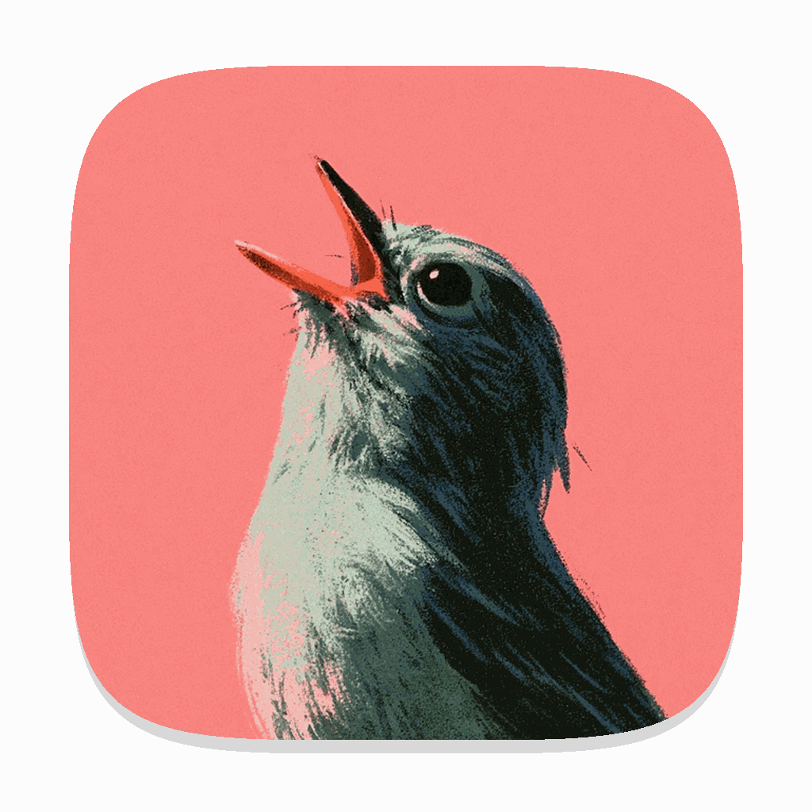

<p align="center">
  
</p>

# Chinwag

Local push-to-talk dictation for macOS, powered by Cohere Transcribe on Apple Metal.

## Install

Requires Apple silicon, macOS 14+, and Xcode command-line tools.

```sh
scripts/service install
```

First launch downloads a 1.56 GB model. Grant Microphone and Accessibility access in Settings.

Optional: pass `--sign "Apple Development: Your Name (TEAMID)"` to preserve permissions across rebuilds.

## Use

Hold **Option-Space**, speak, then release to paste. If focus changed, the text stays on the clipboard. Audio stays on your Mac.

```sh
scripts/service status
scripts/service uninstall
```

Dictation and API clients share one loaded model. Quitting Chinwag stops the API and unloads the model. Installing replaces the old separate service LaunchAgent if present.

## API

OpenAI-compatible transcription for native apps and CLI clients.

```text
Base URL  http://127.0.0.1:3212/v1
POST      /audio/transcriptions
Model     whisper-1
```

No API key required. Use `not-needed` if your client requires one. Loopback only, no HTTP authentication. Keep it private.

Optional [live transcription sidecar](live/README.md): WebSocket PCM streaming on port 3213, with selectable warm local models and pause-chunked Cohere. The app and batch API are unchanged.

## Check

```sh
scripts/check
```

With the model installed, `python3 tests/integration/run.py` tests real Metal transcription and measures warm API latency.
